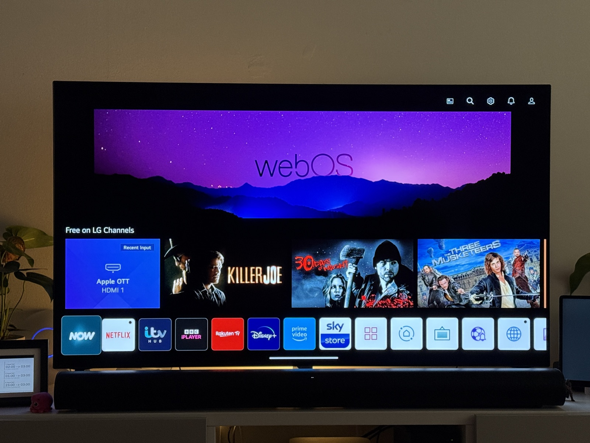
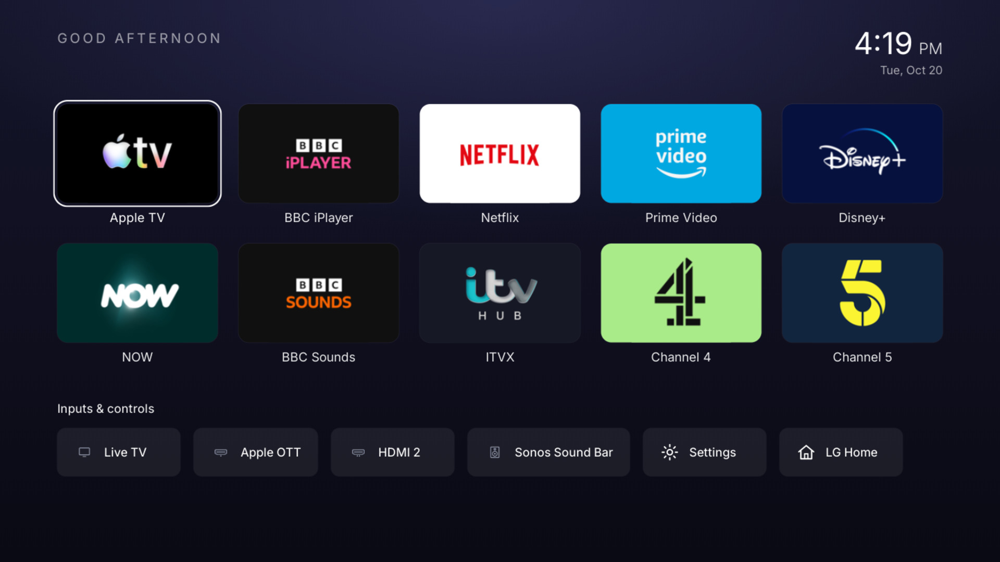
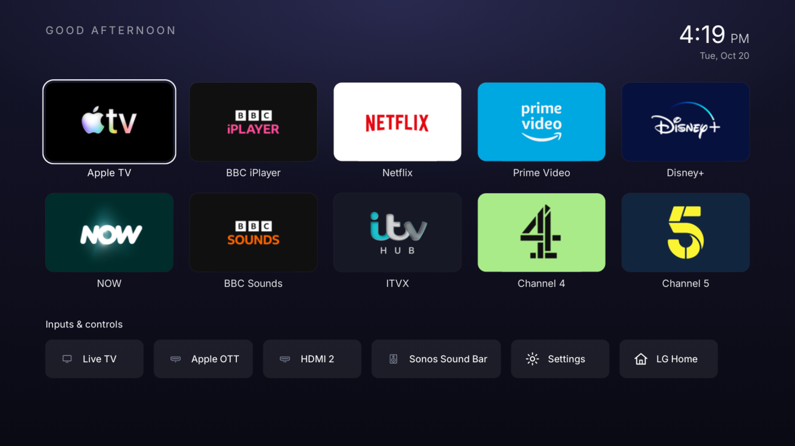

> [!WARNING]
> ## ⚠️ Do this at your own risk.
> **Rooting an LG TV voids its warranty and can permanently brick it.** It is not a
> supported modification, and if it goes wrong on a panel that cannot be recovered there is
> no way back.
>
> Everything here was developed and tested on **exactly one television**, which the author
> owned and was willing to lose. It is published as-is, with no warranty and no support —
> see [LICENSE](LICENSE). A firmware update can close the root path **permanently**, and one
> wrong hook can leave you looking at a black screen.
>
> **Read [docs/safety.md](docs/safety.md) and [docs/compatibility.md](docs/compatibility.md)
> before you run anything.** If you are not comfortable recovering a bricked TV from a USB
> stick, do not start.
>
> I did this to my own TV. You do it to yours, at your own risk.

# unspy

**Turn your LG TV back into a television.**

Strip the ad serving, the viewing-data collection, the microphone path and the LAN snooping — then replace the ad-filled stock home screen with a clean one you actually own, on the remote's HOME button, at every boot.

<sub>An open, reproducible teardown of one LG webOS 6 TV, with the receipts. Root → debloat → **new home screen**. Fully reversible.</sub>

---

## Before / after

Same TV. Same remote. Same apps. Same living room.

|  **Before — stock LG webOS 6** | **After — the unspy launcher** |
|:--:|:--:|
| [](media/before-lg-home.jpg) | [](media/after-launcher.jpg) |
| A shop window. Sponsored tiles, "Free on LG Channels", a rail of whatever LG is being paid to show you. | Greeting, clock, five columns of your apps, and your inputs. Nothing you didn't ask for. |

The left photo is the TV as it shipped. The right photo is the same panel, with the stock home screen gone and the HOME button rewired to my launcher — captured after a cold boot, on the actual TV, on a Sunday evening.

---

## What you get

| | What changed |
|---|---|
| **Home screen** | LG's home screen replaced by the unspy launcher — on every boot, and on every HOME press. |
| **Ads & promo** | 7 promo apps uninstalled; 25 ad / overlay / demo / dev-sample apps neutralised; 11 home-screen promo rails masked (LG's home registry went from 84 entries to 74). |
| **Ad & ACR endpoints** | 21 LG advertising, ACR, telemetry and firmware-update hostnames blackholed through a bind-mounted `/etc/hosts`, re-applied on every boot. |
| **Consent & settings** | 13 privacy settings applied, including Live Plus (ACR) off, Ad Cookie off, "Do Not Sell My Personal Information" on, shop/demo mode off, promo video off. |
| **Microphone** | `voiceinput.service` and `voiceconductor.service` stopped at every boot. No capture pipeline; the consent flags were already declined. |
| **LAN snooping** | mDNS, Avahi, SSDP, `ssc`, `homeconnect` and `apiadapter` disabled, plus UDP 1900/5353 dropped in both directions. |
| **Reversible** | Every change is a file you can delete, a bind-mount you can unmount, or a setting you can flip back. No system partition is modified. See [docs/safety.md](docs/safety.md). |

---

## The launcher

This is the part you look at every day, so it got the most attention. It is a from-scratch restyle of the excellent [`partridgeworks/webos-launcher`](https://github.com/partridgeworks/webos-launcher) (MIT), rebuilt into a proper 10-foot UI.

[](media/launcher-cdp.png)

**What it is**

* **Five columns of full-bleed brand cards.** The TV only hands a sideloaded web app a square icon, so each card is painted with that icon's *own* background colour — sampled from its four corners — and the square bleeds to the card edge: Apple TV goes black-on-black, Netflix white-on-white, Channel 4 green-on-green. Icons with transparent edges fall back to the neutral plate. Every icon is sampled once, at launch.
* A greeting that knows the time of day, top-left, and the clock top-right with the date under it. Both are the only things on screen that change on their own.
* **Two rows of five, scrolled a row at a time**, with the app's name under every card. Focus is an offset white ring — nothing scales, lifts or glows, so your eye stays on the artwork and the grid only moves when it has to.
* **An "Inputs & controls" strip** along the bottom: Live TV, your HDMI inputs named the way you named them, Settings and LG Home. One press down from the last row; up returns to the grid.
* **Sources come from the TV**, named the way you named them. App tiles come from a bundled catalogue, because webOS 6 does not let a sideloaded web app enumerate installed apps or read their icons — only apps your TV reports as installed are shown. An opt-in live app list (via Homebrew Channel) pulls the real list and the real icons.
* No rails, no recommendations, no "free" anything, no LG branding, nothing that can be sold.

**Everything is a number you can change.** The entire design system lives in one file — [`launcher/src/theme/tokens.ts`](launcher/src/theme/tokens.ts):

```ts
export const COLOR = { bg: '#0B0B16', textPrimary: '#FFFFFF', ... };
export const FONT  = { greeting: 26, clockTime: 58, cardLabel: 24, ... };
export const LAYOUT = { edgePadding: 110, gridTop: 200, cardWidth: 308, cardHeight: 190, cardGapX: 40, ... };
export const MOTION = { focusMs: 160, scrollMs: 280, focusScale: 1.14, ... };
```

Change a colour or a size, `npm run build && npm run package`, install. That is the whole customisation story — no CSS hunting.

**It runs on a 2019 browser.** The TV's renderer is Chromium 79, which means no optional chaining, no `??`, no ES modules over `file://`, no flex `gap`, no `inset`, no `aspect-ratio`, no `@property`. The launcher is deliberately plain Preact + plain CSS so it behaves identically on the TV and in a desktop browser while you are designing it.

### How it becomes *the* home screen

Three mechanisms, because no single one is enough:

1. **It installs as an ordinary app.** `works.partridge.webos-launcher`, `systemApp: false`. Nothing is written to a system partition, and LG's own home screen still exists underneath.

2. **The HOME button is remapped.** [LG Input Hook](https://github.com/Simon34545/lginputhook) (`org.webosbrew.inputhook`) intercepts key code `773` and launches my app instead of `com.webos.app.home`. One detail cost me an evening and is worth writing down: **on this TV the HOME press is carried by `micomservice`, not `lginput2`.** Hook only `lginput2` and the remap appears to work in the logs while HOME still opens LG's home screen.

3. **Boot lands on the launcher.** `startup.sh` lives on the writable `/var/lib/webosbrew/`, so one guarded line near its top starts my supervisor a full **8 seconds earlier** than the standard `init.d` run-parts pass (≈34s vs ≈42s uptime). From there:
   * `inputhook-supervisor` injects the hook and **retries** until it takes — early injection is load-dependent and does fail on some boots;
   * `boot-home` brings the launcher to the front and, until the hook is confirmed live, quietly replaces LG's home screen if it grabs the foreground. Then it stops, so the launcher's own "LG Home" tile keeps working normally;
   * `85-homebutton` in `init.d` is a safety net: if a Homebrew Channel update ever overwrites `startup.sh`, the hooks still come up.

**Measured cold boot** on the test set:

```
[34s] startup.sh early hooks
[36s] micomservice hooked
[38s] foreground 'com.webos.app.hdmi1' at boot -> showing the launcher
[40s] lginput2 hooked
[41s] hook is live, stopping
[47s] foreground = works.partridge.webos-launcher
```

**And the honest part:** this is not instant-on. LG's own UI is on screen first, and mine takes over a few seconds later, once the panel is usable. If LG ever ships a firmware that breaks the injection, you get the stock home screen back and nothing else changes.

📖 Full detail: **[docs/launcher.md](docs/launcher.md)**

---

## Why

In September 2026, Gamers Nexus and Level1Techs published *"216,000,000 Spy TVs"*, alleging that LG televisions were using Automatic Content Recognition to collect viewing data, location, IP address, nearby Wi-Fi network names and the names of devices on your LAN — with audio capture in standby. LG responded that its ACR is opt-in and based on audio fingerprinting, with no screenshots or recordings. The Texas Attorney General has sued several TV makers over ACR.

I am not going to settle that argument here, and this repo does not claim to. What it does is simpler and more useful: **I sat down with one of these TVs, measured what it actually does, and cut every path I could — then wrote down exactly what I changed, including the parts I could not verify.**

[docs/privacy.md](docs/privacy.md) is the audit: what I looked at, what I blocked, what I measured, and what I am *not* claiming.

---

## Quick start

**You need:** an LG webOS TV you own, a computer on the same network, and a willingness to read before you type. Rooting is the risky step; everything after it is reversible.

```sh
# 0. Get the repo
git clone https://github.com/sojufx/unspy && cd unspy

# 1. Root the TV (not covered here - follow the community projects)
#    Check your exact model and firmware first:  https://cani.rootmy.tv
#    and the guides at                              https://www.webosbrew.org/rooting/
#    Then install Homebrew Channel; it provides /var/lib/webosbrew/init.d.

# 2. Point the helper tools at your TV and copy the hooks over
#    (a rooted webOS TV gives you a *telnet* root shell - not SSH, and macOS no longer
#     ships a telnet client - so the repo carries two stdlib-only helpers instead)
export TV_IP=<your-tv-ip>
python3 tools/tvpush.py -r scripts /tmp/unspy          # sha256-verified upload
python3 tools/tvtelnet.py 'sh /tmp/unspy/scripts/install.sh'

# 3. Reboot, wait ~50s, then read what the boot hooks actually did
python3 tools/tvtelnet.py 'reboot'                     # the shell dies with the TV - expected
sleep 50
python3 tools/tvtelnet.py 'cat /tmp/inputhook-boot.log'
```

The installer is idempotent — running it again is a no-op — and `sh install.sh --revert` removes everything it installed.

Then build and install the launcher:

```sh
cd launcher
npm install
cp tv.env.example tv.env      # set TV_IP (rooted) or TV_HOST (SSH)
npm run deploy                # build, package, install onto the TV, launch it
```

Read [docs/safety.md](docs/safety.md) before you start, and [docs/compatibility.md](docs/compatibility.md) to find out whether your TV is a candidate at all.

> **Do not install a firmware update before you know your ceiling.** On my set, an update past a specific version permanently removes the root path. Numbers in [docs/compatibility.md](docs/compatibility.md).

---

## Compatibility

Root exploits are **model and firmware specific**, not version-generic. The table below is aggregated from the [`@webosbrew/caniroot`](https://github.com/webosbrew/caniroot) dataset that powers [cani.rootmy.tv](https://cani.rootmy.tv) — 119 devices, 8 exploit families.

| Model year | Devices in dataset | Newest exploit still available |
|---|---|---|
| 2015–2016 | 25 | `nvm`, `mvpd` (pre-webOS 3.5 era) |
| 2017 | 8 | `rootmytv`, `nvm`, `dejavuln` |
| 2018–2019 | 22 | `rootmytv`, `crashd`, `asm`, `dejavuln`, `faultmanager` |
| 2020–2021 | 18 | all of the above, plus `wta` |
| 2022 | 6 | `dejavuln`, `faultmanager`, `crashd`, `asm`, `wta` |
| 2023 | 8 | `dejavuln`, `faultmanager`, `crashd`, `asm`, `wta` |
| **2024** | 7 | **`faultmanager` only** |
| **2025+** | — | **nothing known** — treat as unrootable |

`dejavuln` (the exploit used here) is available across 82 devices from 2017 through 2023 and is **absent from every 2024 and 2025 device in the dataset**. Anything newer than 2023 should be assumed unrootable until the community says otherwise.

**This repo's boot mechanism depends on Homebrew Channel's `/var/lib/webosbrew/init.d` run-parts pass**, which exists on every rooted webOS TV. The launcher itself targets webOS 6 (Chromium 79) and needs adaptation for older or newer renderers.

📖 Exact per-model firmware ceilings, and why the number matters: **[docs/compatibility.md](docs/compatibility.md)**

---

## Tested on

One TV, end to end, with a cold boot verified four times.

| | |
|---|---|
| **Panel** | LG `OLED55A16LA` (OLED A1, 48/55/65/77", DVB, DE/PL/UK) |
| **OTA ID** | `HE_DTV_W21U_AFADATAA` — codename `kisscurl`, machine `lm21u` |
| **webOS** | `6.3.3-438` |
| **Firmware** | `03.36.30` |
| **SoC / arch** | ARMv7 |
| **Renderer** | Chromium `79.0.3945.79` |
| **Apps inventoried** | 117 |
| **Root method** | `dejavuln-autoroot` via USB (kept the root shell open) |
| **Injector** | LG Input Hook 1.5.1, SHA-256 `604d556a…c88ec` |

It was verified on exactly this hardware. Other 2021-era LG sets on the same `lm21u`/`kisscurl` platform are the best bet for a copy-paste result; everything else is untested and you should expect to adapt it. If you run it on a different panel, please open an issue with your OTA ID and firmware — that is how the compatibility table gets better.

---

## What this does *not* do

I would rather you trust the parts that are true.

* **It does not stop ACR inside LG's own code.** I switch ACR off at the setting, blackhole the endpoints it talks to, and decline the consent flags. I cannot prove that nothing is collected, and I do not claim to have.
* **It does not fix the TV's other network traffic.** Streaming apps still talk to their own servers — that is what streaming is.
* **It breaks a few things on purpose.** No DLNA browsing from the TV, no AirPlay/Miracast discovery *to* the TV (`LGwebOSTV.local` stops answering), and no control from the LG ThinQ app. Each is documented and independently reversible.
* **It is not a security boundary.** Hosts-file blackholing is a roadblock, not a wall. Anyone with root on the TV can undo it, and it does nothing about what the TV sends over a tunnel.
* **IPv6 discovery is not firewalled on this set** — the kernel has no `ip6_tables`. Block it at your router if you care. The script says so out loud at boot.
* **The launcher is a restyle of someone else's app**, not a from-scratch rewrite. Upstream is MIT and is credited in full. What I changed is the visual layer (`theme/tokens.ts`, `theme/global.css`, the card grid in `components/AppGrid.tsx` / `Tile.tsx` / `InputStrip.tsx`, and `lib/accent.ts`) plus the layout and key handling in `Home.tsx`. The Luna plumbing, app catalogue and packaging are upstream's work, and they are good work.
* **Boot is not instant.** A few seconds of LG's UI before the launcher takes over.

---

## Safety & rollback

Nothing here writes to a read-only partition. Every mechanism has an undo, and most are undone by deleting one file and rebooting.

```sh
# undo one API-visible change
rm /var/lib/webosbrew/init.d/50-debloat-blocklist && umount /etc/hosts && reboot

# undo everything this repo installed
sh scripts/install.sh --revert          # or, by hand:
rm -f /var/lib/webosbrew/init.d/{50-debloat-blocklist,60-debloat-hideapps,65-debloat-homescreen,70-debloat-novoice,80-debloat-nodiscovery,85-homebutton}
rm -f /var/lib/webosbrew/{early-hooks,inputhook-supervisor,boot-home}
reboot
```

> **Do not `umount -a`.** The bind-mounts and stopped units are all per-boot state, so a
> reboot clears them. To drop the mounts *without* rebooting, unmount the specific app dirs
> — never unmount tmpfs wholesale, because the TV's own `/tmp` and runtime mounts live
> there. The loop that does it safely is in [docs/safety.md](docs/safety.md#rollback).

The TV's own failsafe is untouched: Homebrew Channel's emergency telnet server and its "crash during startup" recovery still work exactly as before.

📖 **[docs/safety.md](docs/safety.md)** — what each hook touches, what it costs you, and how to get out.

---

## Repo layout

```
unspy/
├── scripts/          boot hooks + the installer, run on the TV
│   ├── install.sh              the one command
│   ├── 50-debloat-blocklist    blackhole ads / ACR / telemetry / update hosts
│   ├── 60-debloat-hideapps     neutralise 25 ad & demo apps
│   ├── 65-debloat-homescreen   strip LG's promo rails
│   ├── 70-debloat-novoice      stop the microphone capture services
│   ├── 80-debloat-nodiscovery  mDNS / SSDP / device enumeration off
│   ├── early-hooks             start the home-screen hooks 8s earlier
│   ├── inputhook-supervisor    inject LG Input Hook, and keep it injected
│   ├── boot-home               boot into the launcher, hold it until HOME works
│   └── 85-homebutton           init.d safety net for the two above
├── launcher/         the home screen (MIT, forked + restyled)
│   └── src/theme/tokens.ts     ← the entire design
├── tools/            host-side helpers used while building this
│   ├── tvtelnet.py             telnet helper (the TV's shell drops idle fast)
│   ├── tvpush.py               push files to the TV
│   ├── tv-cdp.mjs              drive the TV's DevTools and screenshot it
│   ├── tv-inspector.mjs        evaluate JS in the running launcher
│   └── tv-keys.mjs             send remote key codes
├── docs/
│   ├── privacy.md              the audit, and what I can't claim
│   ├── launcher.md             the home screen, in depth
│   ├── compatibility.md        which TVs, which firmware, which ceilings
│   └── safety.md               what it touches and how to undo it
└── media/
```

---

## Credits

This stands on other people's work, and none of it is hidden:

| Project | Licence | What it does here |
|---|---|---|
| [`throwaway96/dejavuln-autoroot`](https://github.com/throwaway96/dejavuln-autoroot) | AGPL-3.0 | the root exploit |
| [Homebrew Channel](https://github.com/webosbrew/webos-homebrew-channel) | MIT | `init.d` run-parts, the writable `/var/lib/webosbrew/`, failsafe telnet |
| [`Simon34545/lginputhook`](https://github.com/Simon34545/lginputhook) | BSD-3-Clause | HOME button remapping |
| [`partridgeworks/webos-launcher`](https://github.com/partridgeworks/webos-launcher) | MIT | the launcher this home screen is forked from |
| [`webosbrew/caniroot`](https://github.com/webosbrew/caniroot) | MIT | the compatibility dataset behind the table above |
| [Preact](https://preactjs.com) · [Inter](https://rsms.me/inter/) | MIT · OFL-1.1 | launcher runtime and typeface |

See **[NOTICE.md](NOTICE.md)** for the full list, including the upstream licences and the trademark position on app icons.

---

## Contributing

The most valuable thing you can send is **a different TV**. Run `tools/tvtelnet.py` against it, capture the boot log, and open an issue with:

* the OTA ID (`luna-send -n 1 luna://com.webos.service.tv.systemproperty/getSystemInfo '{"keys":["otaId","modelName","firmwareVersion"]}'`)
* your `webOS` and firmware versions
* which daemon actually carries the HOME key code on your set — see the probe notes in [docs/launcher.md](docs/launcher.md)

Launcher pull requests are welcome; keep it Chromium 79-safe and keep the design in `tokens.ts`.

---

## Licence

This project's own code: **MIT** — see [LICENSE](LICENSE). The launcher fork keeps its own MIT licence and third-party notices in `launcher/`. Third-party components keep theirs; see [NOTICE.md](NOTICE.md).

> **Disclaimer.** This is an independent, unofficial project. It is not affiliated with, endorsed by or sponsored by LG Electronics or any app vendor. Rooting your TV voids its warranty and carries real risk — you are modifying a device you paid for, and you can break it. Everything here was written against one TV that I own and was willing to brick. Read it before you run it.
