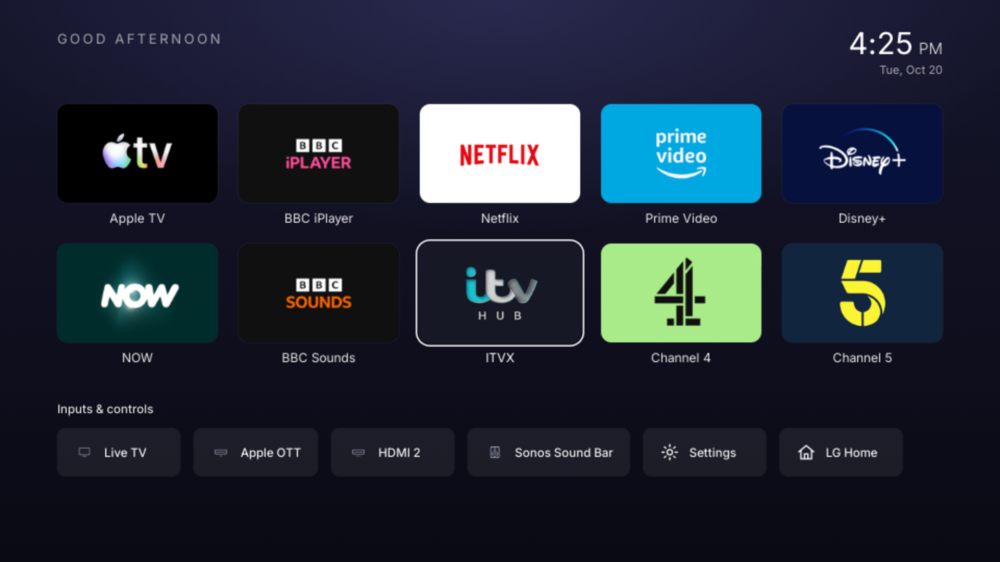
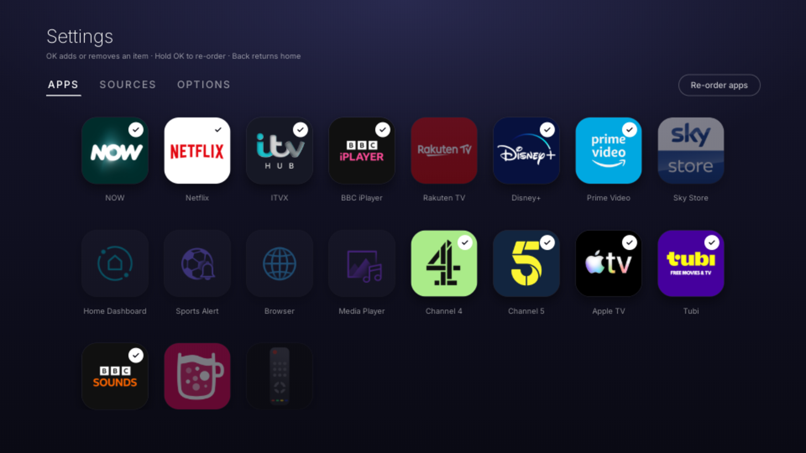

# The launcher

The home screen that replaces LG's. How it looks, how it is built, and how it ends up in
front of you at every boot.

[](../media/launcher-cdp.png)

> My build is a **restyle** of [`partridgeworks/webos-launcher`](https://github.com/partridgeworks/webos-launcher)
> (MIT), installed as `works.partridge.webos-launcher` **1.1.0**. Upstream wrote the
> plumbing — the Luna bridge, the app catalogue, the packaging, the remote-key handling.
> I rebuilt the visual layer and invented the home-screen integration. Both are credited
> in [NOTICE.md](../NOTICE.md).

---

## The look

The brief is LG's own 2024 home screen, not Apple TV: landscape cards with labels
underneath, a clock in the corner, a strip of inputs along the bottom. The engine is a 2019
Chromium with no flexbox `gap`, no `inset` and no `aspect-ratio`, so the grid is absolute
positioning against layout tokens, and the focus ring is a pseudo-element (Chrome 79 cannot
round an `outline`).

**Cards carry their own colour.** A sideloaded web app only ever gets a square icon, so a
card cannot show the wide brand art LG's own home screen uses. The next best thing is to
stop fighting the square: each icon is drawn into a 24×24 canvas, its four corner pixels are
sampled, and if they agree the card is painted that colour, edge to edge. Apple TV becomes a
black card with a black icon, Netflix a white card, Channel 4 a green one — the square is
invisible because the card *is* the square's background. Icons with transparent or
inconsistent corners fall back to the neutral plate, and the icons with a diagonal or a glow
(Prime Video, Disney+) keep their own rounded artwork on the plate instead. The sampling is
done once at launch and cached per icon URL.

[](../media/launcher-scroll.png)

<sub>The same screen one press down and two to the right: ITVX focused. Nothing scales, lifts or glows; the ring is the whole focus state.</sub>

```
components/AppGrid.tsx    five-column track, scrolled a whole row at a time
components/Tile.tsx       card (home) and square (settings) variants; ring via ::after
components/InputStrip.tsx "Inputs & controls": chips for inputs, Settings, LG Home
lib/accent.ts             accentFor() for monogram colour; plateFor() samples the icon's
                          four corners into a card background, cached by URL
```

**Focus is a ring, not a lift.** The selected card gets an offset white outline drawn 8px
outside its edge; it does not grow, lift or take a shadow, and the rest of the grid does not
dim. On a wall-sized panel that reads as a cursor you can find from the sofa, without the
grid moving under your thumb. The pointer is hidden on open
(`webOSSystem.setCursorHidden(true)`) — shake the Magic Remote to get it back.

**One Chromium 79 trap worth writing down.** The first frame painted after a *reload* can be
rasterised into a surface the TV's compositor then overwrites, and the text drawn in that
frame (here: the greeting, the clock and the date) keeps drawing garbage glyphs until
something forces it to repaint. Fresh launches are usually fine; a hot reload is not. The
launcher adds a `.settled` class 1.5 seconds after launch, which nudges the tracking of
those three runs by a fraction of a pixel and repaints them. The practical rule that came out
of it: keep `letter-spacing` at `normal` or whole pixels on large text, and never trust a
single TV screenshot.

**Everything is a token.** Colours, type scale, layout and motion live in one file:

```ts
// launcher/src/theme/tokens.ts
export const COLOR  = { bg: '#0B0B16', textPrimary: '#FFFFFF', ring: 'rgba(255,255,255,0.96)', ... };
export const FONT   = { greeting: 26, clockTime: 58, cardLabel: 24, tileLabel: 18, ... };
export const LAYOUT = { screenWidth: 1920, edgePadding: 110, gridTop: 200, cardWidth: 308,
                        cardHeight: 190, cardGapX: 40, stripBottom: 165, chipHeight: 92, ... };
export const MOTION = { focusMs: 160, scrollMs: 280, focusScale: 1.14 };
```

`applyTokens()` publishes them to `:root` as CSS custom properties, so the stylesheet and
the components read the same numbers. Change `cardRadius` from `20` to `4`, rebuild, and
every card follows.

---

## What is on screen

| Zone | Contents | Source |
|---|---|---|
| top-left | the greeting — *Good afternoon* | the local clock |
| top-right | the time, the date under it | the local clock |
| grid | your apps, in your order, five per row, two rows visible | bundled catalogue ∩ what the TV says is installed |
| strip | Live TV, the HDMI inputs, Settings, LG Home | `com.webos.service.eim/getAllInputStatus` — real inputs, with the names you set in the TV's Input settings |

**Why a catalogue rather than the live app list?** On webOS 6, sideloaded web apps are
*denied* `listLaunchPoints`, `listApps`, `getAppInfo` and `getForegroundAppInfo` — a web app
cannot see what is installed or read its icons. It *is* allowed
`applicationManager/getAppLoadStatus`, so the launcher shows catalogue entries only for
apps the TV confirms are there. Apps with no bundled icon get a monogram tile.

If you are rooted, there is an opt-in escape hatch: **Settings → Options → Live app list via
Homebrew Channel**, which asks the Homebrew Channel's service (running as root) to run the
blocked calls and base64-encode the real icons. It sends fixed commands only; icon paths
are validated and shell-quoted, and app IDs never reach the shell.

To add your own apps without editing tracked files:

```sh
cp src/config/catalog.local.example.ts src/config/catalog.local.ts   # git-ignored
```

---

## Controls

| Where | Key | Does |
|---|---|---|
| Home | ↑ ↓ | move between rows; down from the last row enters the strip, up returns to the grid |
| Home | ← → | move along a row, or along the strip |
| Home | OK | open the app or input |
| Settings | OK | add or remove an app/source |
| Settings | Hold OK / **Re-order** | enter or leave re-order mode |
| Re-order | OK, arrows, OK | pick a tile up, move it, put it down |
| Anywhere | Back | return home / leave re-order |

[](../media/launcher-settings.png)

Adding and removing is a grid of every app it knows about, with the ones currently on your
home screen badged. Re-ordering is a mode, so you cannot do it by accident.

---

## How it becomes the home screen

Three mechanisms. Any one alone is not enough.

### 1. It installs as a normal app

`works.partridge.webos-launcher`, `version 1.1.0`, `systemApp: false`. Nothing is written to
a system partition, LG's home screen still exists underneath, and uninstalling it returns
you to stock.

```sh
cd launcher
npm install
cp tv.env.example tv.env      # TV_HOST=root@<your-tv>
npm run deploy                # build -> package -> install -> launch
```

### 2. The HOME button is remapped

[LG Input Hook](https://github.com/Simon34545/lginputhook) injects a shared library into the
running input daemons and matches key codes against a keybind file. Key code **773** is Home:

```json
{"773": {"action": "launch", "id": "works.partridge.webos-launcher"}}
```

Written to the Input Hook service's keybind file. It hot-reloads, so no reboot is needed to
test. `launch` is one of four actions: `launch`, `exec`, `replace`, `ignore` — which is how
you would map other buttons.

**The trap.** On this TV the HOME press is carried by **`micomservice`**, not `lginput2`.
`micomservice` writes key codes to `/dev/uinput` and starts *before* `lginput2`. Hook only
`lginput2` and the log will happily tell you the key was remapped while HOME still opens
LG's home screen — because the press never went through the daemon you hooked.

### Finding your own HOME-button carrier

Do this on your TV before blaming the keybind file. With the hook loaded:

```sh
# which processes have the hook?
for p in /proc/[0-9]*; do
  comm=$(cat $p/comm 2>/dev/null)
  grep -q libinputhookpp $p/maps 2>/dev/null && echo "hooked: $comm (${p#/proc/})"
done

# then watch Input Hook's own log while you press HOME
tail -f /tmp/lginput-hook-micomservice.log
tail -f /tmp/lginput-hook-lginput2.log
```

Whichever log shows `code=773 → Key 773 is launch → luna-send …/launch` when you press HOME
is your carrier. Mine is `micomservice`. `inputhook-supervisor` hooks every known candidate
(`micomservice lginput2 tvservice RELEASE testapp`) for exactly this reason.

### 3. Boot lands on the launcher

**The problem.** `/var/lib/webosbrew/init.d` is a `run-parts` pass, and on this TV it does
not run until **≈42s** uptime. The input daemons are up at **≈13s** and the TV is usable
from **≈30s**. Forty-two is too late: the TV is already showing LG's home screen.

**The fix.** `startup.sh` sits on the writable `/var/lib/webosbrew/` and is executed by
`devmode.service` at **≈21s**. So one guarded line near its top starts my hooks a full
8 seconds earlier, and everything in it is backgrounded so the boot is not delayed:

```bash
# in /var/lib/webosbrew/startup.sh, immediately after `touch "${once}"`
[ -x /var/lib/webosbrew/early-hooks ] && /var/lib/webosbrew/early-hooks
```

`early-hooks` just launches two detached processes:

```sh
setsid /var/lib/webosbrew/inputhook-supervisor >>/tmp/inputhook-boot.log 2>&1 &
setsid /var/lib/webosbrew/boot-home            >>/tmp/boot-home.log     2>&1 &
```

**`inputhook-supervisor`** polls for the daemons and injects the hook, then keeps polling
(slowly, forever) so a restarted daemon gets re-hooked. It logs a failure **once per
process** rather than once per poll, and it touches `/tmp/inputhook` so Input Hook's own
loader knows not to inject twice.

**Why retrying matters.** Early injection into `micomservice` is load-dependent and does
fail. On one measured boot it failed at 37s and succeeded at 51s. A one-shot injector would
have left HOME unremapped for that entire session.

**`boot-home`** is the safety net for the window before the hook lands — and it has to be
careful, because "keep the launcher in front" and "let the user open Netflix" are the same
instruction if you are clumsy about it:

* it re-asserts the launcher only for the first `SETTLE=20` seconds after boot;
* after the launcher has held the foreground for 3 consecutive checks, it **stops
  re-asserting it entirely**;
* until the hook is confirmed live it also replaces LG's home screen whenever *that* grabs
  the foreground;
* the moment `hook_live` is true — a `micomservice` process with `libinputhookpp` in its
  maps — it stops and exits. That is what keeps the launcher's own "LG Home" tile working
  normally, because after that point LG's home screen is something you asked for.

**`85-homebutton`** in `init.d` runs the same two helpers as a fallback, in case a Homebrew
Channel update ever overwrites `startup.sh`. Both helpers are single-instance (pidfile), so
running them twice is harmless.

### The measured boot

```
[34s] startup.sh early hooks
[36s] micomservice hooked
[38s] foreground 'com.webos.app.hdmi1' at boot -> showing the launcher
[40s] lginput2 hooked
[41s] hook is live, stopping
[47s] foreground = works.partridge.webos-launcher
```

Verified across four cold reboots. Logs at `/tmp/inputhook-boot.log` and `/tmp/boot-home.log`.

---

## Developing the UI

The TV exposes a Chrome DevTools endpoint on port **9998**, which is how a 1080p screenshot
was taken without leaving the desk.

```sh
node tools/tv-cdp.mjs Emulation.clearDeviceMetricsOverride
node tools/tv-shot.mjs     shot.png          # page screenshot
node tools/tv-inspector.mjs "document.title" # evaluate JS in the running app
node tools/tv-keys.mjs     LEFT RIGHT OK     # drive the remote
```

Fast iteration without rebuilding the ipk:

```sh
sh tools/deploy.sh          # push dist/ straight into the installed app, then reload
cd launcher && npm run dev  # or design in a desktop browser against the same build
```

`deploy.sh` verifies the pushed file size on the TV before reloading, because the telnet
helper's own sha256 readback is unreliable and reports a false mismatch.

> **Stop here and read this if you are porting.** `find` segfaults on this TV. Use `ls` and
> `grep`. Busybox `cp -n` silently fails. The telnet shell drops after ~3s idle, so
> background long remote commands and poll for the output.

---

## Known limits

* **Not instant-on.** LG's UI is on screen first; the launcher takes over once the panel is usable
  — a few seconds. This is a redirect, not a bootloader.
* **The hook is volatile.** It lives in the daemons, so every reboot loses it and the
  supervisor has to re-inject. If injection is ever permanently broken by a firmware
  update, you get the stock home screen and nothing breaks.
* **HOME can still open LG's home screen** if you press it *before* the hook is live. That
  window is 2–3 seconds on a normal boot, and `boot-home` covers it.
* **The launcher does not replace `com.webos.app.home`.** `com.webos.app.home` is a signed,
  read-only native shell — it cannot be rebuilt, and hiding it bricks the TV.
* **Twelve-second boot tax, measured on one TV.** Do not assume the same timings on a
  different model; measure first, then decide whether `early-hooks` earns its place.
