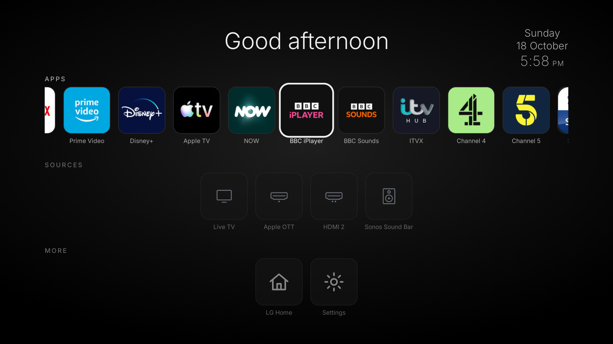

# The privacy audit

What we changed, why, how to check it yourself — and what we are **not** claiming.

---

## Background

In September 2026, Gamers Nexus and Level1Techs published an investigation titled
*"216,000,000 Spy TVs"*, alleging that LG televisions used Automatic Content Recognition
(ACR) to collect viewing data, location, IP address, nearby Wi-Fi network names and the
names of other devices on the local network, with audio capture continuing in standby. LG
responded on 12 September 2026 that its ACR is opt-in and uses audio fingerprinting, with
no screenshots or recordings. The Texas Attorney General has since sued several TV
manufacturers over ACR practices.

We have no inside knowledge and no packet capture of LG's backend. What we have is one TV,
a root shell, and the willingness to look. This document is the result of that look.

---

## What the TV's own consent state said

Before changing anything, we read the consent flags LG keeps on the device:

```sh
cat /var/luna/preferences/eula
```

```
voiceAllowed:false
voice2Allowed:false
acrAllowed:false
```

Already declined — this TV had never consented to voice or ACR. That is reassuring up to a
point, and it is also the reason some of what follows is belt-and-braces: **we are not
auditing a consent flag, we are removing the machinery behind it.**

---

## 1. Settings

Thirteen documented settings, applied through LG's own settings service. No hacking
involved — these are values the TV's Settings app writes, and the TV's menus can write
them back.

```sh
sh scripts/debloat-settings.sh      # prints before, applies, prints after
```

| Category | Setting | Value | What it governs |
|---|---|---|---|
| `general` | `adCookie` | `off` | the advertising cookie |
| `general` | `doNotSellMyPersonalInformation` | `on` | the do-not-sell flag |
| `general` | `sportsAlarm` | `off` | push alerts that reveal viewing |
| `general` | `noSignalGuideArea` | `off` | guide overlays on dead inputs |
| `general` | `welcomeFeature` | `off` | onboarding promo surface |
| `general` | `voiceLongDistance` | `off` | long-distance voice queries |
| `option` | `demoMode` | `off` | shop demo mode |
| `option` | `storeMode2` | `off` | retail/store mode |
| `option` | `webOSPromotionVideo` | `off` | promotional video playback |
| **`option`** | **`livePlus`** | **`off`** | **LG's ACR feature — the one the investigation is about** |
| `option` | `promotionStreamer` | `off` | promo streaming rail |
| `option` | `channelplus` | `off` | LG's ad-supported channel service |
| `option` | `watchedListCollection` | `off` | watched-content collection |

---

## 2. Endpoints blocked

21 hostnames, blackholed by generating a hosts file in `/tmp` and bind-mounting it over
the read-only `/etc/hosts` — the same trick Homebrew Channel uses for its own update
blocking. Re-applied from `init.d` on every boot, so it survives menu changes and reboots.

```sh
sh scripts/50-debloat-blocklist
```

| Group | Hosts |
|---|---|
| LG ad delivery | `ad.lgappstv.com`, `ads.lgappstv.com`, `lgsmartad.com`, `eu.lgsmartad.com`, `us.lgsmartad.com` |
| LG ad/analytics platform (SDP) | `us.lgtvsdp.com`, `eu.lgtvsdp.com`, `sb.lgtvsdp.com`, `sdp.lgtvsdp.com`, `info.lgtvsdp.com` |
| LG common telemetry | `lgtvcommon.com` |
| Alphonso (ACR vendor) | `alphonso.tv`, `www.alphonso.tv` |
| ACR / analytics APIs | `aci.lge.com`, `aci-api.lge.com`, `lgtvonline.lge.com`, `ngfts.lge.com` |
| Firmware update | `snu.lge.com`, `su.lge.com`, `su-ssl.lge.com`, `su-dev.lge.com` |

The update hosts matter beyond privacy: they are what stops the TV from quietly moving you
past your own rootable firmware ceiling. See [compatibility.md](compatibility.md).

**Verify:**

```sh
nslookup ad.lgappstv.com            # -> 0.0.0.0 / ::  (and the mount)
cat /proc/mounts | grep '/etc/hosts'
```

---

## 3. Apps removed and neutralised

`/usr` and `/mnt/otncabi` are read-only squashfs overlays. You cannot delete what is on
them. You *can* bind-mount an empty directory over an app's folder — the app manager then
finds no `appinfo.json`, so the app is neither indexed nor launchable. It costs nothing,
and `umount` puts it back.

**Uninstalled outright (7)** — these were installed into the writable app area, so they
could genuinely be removed:

```
webos.day                        com.lgshop.app35
com.lgtravel.app                 com.twin.app.audiochannel
epoxyaisports                    com.lgtvod.app
com.miniclip.eightballpool
```

**Neutralised by bind-mount (25)** — advertising, shopping, demo and developer-sample apps:

| Kind | Apps |
|---|---|
| Ad/overlay | `com.webos.app.adapp`, `com.webos.app.care365`, `com.webos.app.dangbei-card`, `com.webos.app.dangbei-overlay` |
| Shopping rails | `com.webos.app.shoppinghdmi1` … `shoppinghdmi4`, `com.webos.app.shoppingoverlay` |
| Demo/store | `com.webos.app.store-demo`, `com.webos.app.sync-demo` |
| Dev samples | 13 × `com.webos.exampleapp.*` |
| Promo | `google.assistant.promo` |

**Kept on purpose:** every streaming app you installed, and
`com.webos.app.facebooklogin` (third-party login — some streaming apps use it to sign in).

The script is idempotent: it skips anything already mounted, so repeated runs never stack
mounts.

---

## 4. The home screen's promo rails

webOS 6's home screen is `com.webos.app.home`, a signed native shell that pulls tiles and
rails from other preinstalled apps. LG exposes no setting to hide those rails —
`homePromotion`, `personalRecommend`, `aiChannel`, `channelplus`, `promotionStreamer` and
`webOSPromotionVideo` were all already off. So the same bind-mount treatment was applied
to the eleven apps that supply the promo content:

```
com.webos.app.discovery      com.webos.app.livepick     com.webos.app.livedmost
com.webos.app.igallery       com.webos.app.membership   google.assistant
amazon.alexa.view            amazon.alexapr             com.webos.app.beanbrowser
com.webos.app.enactbrowser   com.webos.app.voiceweb
```

LG's home registry shrank from **84 to 74 entries** as a result. We deliberately did *not*
touch `com.webos.app.home` itself (hiding it bricks the TV), ui30, the HDMI input apps,
Live TV or Settings.

This is what it looked like before masking, straight off the TV's own DevTools endpoint:

[](../media/lg-home-cdp.png)

Three sponsored films we did not ask for, under a heading that says "Free".

Then we went further and stopped using LG's home screen at all — see
[launcher.md](launcher.md).

---

## 5. The microphone path

The investigation's most serious allegation is audio capture. The consent flags were
already declined here, but a declined flag is a promise, not a firewall. So the capture
daemons are stopped at every boot:

```sh
systemctl stop voiceinput.service       # microphone capture
systemctl stop voiceconductor.service   # voice orchestration
```

Both are `static` units with `Restart=on-failure`. A clean stop keeps them down for the
session; systemd brings them back next boot, which is exactly why this runs from
`init.d`. The script then **checks `ps` and complains loudly at boot if either daemon is
still alive** rather than assuming it worked.

**Deliberately not touched:** `com.webos.app.voice` — despite the name, it is the "Search"
app (`params.launchMode: "vkb"`), i.e. ordinary keyboard search. Removing it would take
search with it.

---

## 6. LAN and device enumeration

The report alleged the TV enumerates devices on the LAN — phones, watches, routers,
thermostats, air purifiers, PCs, even server management interfaces — well beyond what
pairing requires. Three layers, because no single one is sufficient:

| Layer | What |
|---|---|
| systemd units stopped | `avahi-daemon.socket`, `avahi-daemon.service`, `avahi-adaptor.service`, `mdnsd.service`, `ssdp-discovery-lgtv.service`, `ssc.service` (the **`.socket` matters** — kill the daemon alone and it respawns on demand) |
| Luna services unmounted | `com.webos.service.homeconnect` (smart-home enumeration), `com.webos.service.apiadapter` (companion-app API) |
| Firewall | UDP `1900` (SSDP/UPnP) and UDP `5353` (mDNS) dropped both directions, IPv4 and IPv6, because `iconnectivity`/`upnpd` are supervised by `ls-hubd` and respawn the moment they are killed |

**This one has real costs, by design:** no DLNA browsing from the TV, no AirPlay/Miracast
discovery *to* the TV and no `LGwebOSTV.local`, and no control from the LG ThinQ app.

**Known limitation:** this kernel has no `ip6_tables`, so IPv6 discovery cannot be
firewalled on-device. The script prints a warning at boot instead of pretending. Block it
at your router if it matters to you.

---

## What we could not verify — and are not claiming

Being precise about this is the whole point of publishing.

* **We did not read LG's binaries.** We did not decompile `com.webos.app.acr` or the
  telemetry clients. We know which endpoints the TV resolves and reaches, not what it puts
  in the payload.
* **DNS blackholing is a roadblock, not a wall.** The TV has the IP addresses of LG's
  servers compiled in; a hosts-file entry stops name resolution, not a connection to a
  literal IP.
* **No packet capture of ACR itself.** We did not set up a mirrored port or a TLS
  interception proxy. We cannot tell you what data would have been sent — only that the
  destinations no longer resolve.
* **Standby audio capture was not independently tested.** We have no way to be confident
  one way or the other about a microphone in standby on this panel, so we removed the
  capture daemons rather than arguing the point.
* **ACR could exist in more than one place.** We disabled the setting, blocked the known
  endpoints and removed the promo surface. That is three independent layers, not a proof.
* **We did not audit the streaming apps**, whose own tracking is entirely outside LG's
  control — and is the reason plenty of people debloat a TV and still see ads.

## Checking it yourself

Everything above is reproducible from a root shell:

```sh
# consent flags
cat /var/luna/preferences/eula

# what is blocked and whether the mount is live
cat /proc/mounts | grep -e /etc/hosts -e debloat-empty

# what is still running that could capture or enumerate
ps -ef | grep -E 'voiceinput|voiceconductor|homeconnect|apiadapter|avahi|ssdp|ssc'

# what the TV is listening on / connected to
netstat -tunap 2>/dev/null | head -40

# our own boot log, with uptime timestamps
cat /tmp/inputhook-boot.log /tmp/boot-home.log
```

If you find something we missed, that is the most useful issue you can open.
